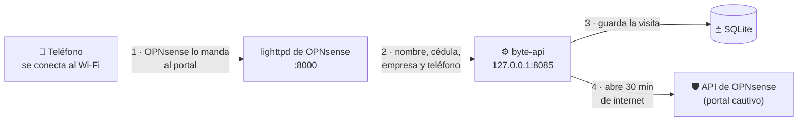

<h1 align="center"> Byte Services - Portal cautivo (Wi-Fi de visitantes) </h1>

<p align="center">
  El visitante escribe nombre, cédula, empresa y teléfono y recibe 30 minutos de internet.<br />
  El acceso lo abre OPNsense a través de la API de Byte.
</p>

<p align="center">
  
  
  
  
</p>

<p align="center">
  
  
  
  
  
  
</p>

<p align="center">
  
  
  
  
</p>

<p align="center">
  <a href="https://github.com/TipoTramquilo/byteservices-portal/actions/workflows/ci.yaml">
    
  </a>
</p>

<div align="center">

## Stack Tecnológico

| Categoría             | Tecnologías Utilizadas                                                    |
| :-------------------- | :------------------------------------------------------------------------ |
| **Portal**            | **HTML + CSS + JavaScript ES2020**, sin dependencias en runtime           |
| **API**               | **Go 1.27**, ports & adapters, **SQLite** (`modernc.org/sqlite`, sin CGO) |
| **Router**            | **OPNsense** (API REST del portal cautivo)                                |
| **Tareas**            | **Task** (`Taskfile.yml`)                                                 |
| **Package Manager**   | **pnpm** (solo herramientas de desarrollo)                                |
| **Calidad de Código** | **Oxlint** & **Oxfmt** (JS), **golangci-lint** & **govulncheck** (Go)     |
| **Testing**           | **go test** (`-race`), **es-check** (ES2020), **k6** (carga)              |
| **Git Workflows**     | **Husky** (`pre-commit`, `commit-msg`, `pre-push`, `post-checkout`)       |
| **Documentación API** | **OpenAPI 3.2** ([openapi.yaml](docs/reference/api/openapi.yaml))         |
| **Contenedores**      | **Multi-stage**, runtime **scratch**, **non-root**                        |

</div>

<div align="center">

## ⚙️ Requisitos Previos

| Herramienta             | Para qué                                    | Versión                                       |
| :---------------------- | :------------------------------------------ | :-------------------------------------------- |
| **Task**                | Todas las tareas del repo                   | 3.x                                           |
| **Go**                  | La API (con uno más viejo se descarga solo) | la de [`apps/api/go.mod`](apps/api/go.mod)    |
| **Node.js**             | Compilar el portal y las herramientas de JS | 26+ (`engines` en `package.json`)             |
| **pnpm**                | Dependencias de desarrollo                  | `packageManager` en `package.json`           |
| **Podman** o **Docker** | Contenedor                                  | con compose                                   |

</div>

> [!IMPORTANT]
> `task` no viene instalado en ningún sistema. Se instala con:

<div align="center">

| Sistema                                                                               | Comando                                                 |
| :------------------------------------------------------------------------------------ | :------------------------------------------------------ |
| macOS ([Homebrew](https://brew.sh))                                                   | `brew install go-task`                                  |
| Linux (snap)                                                                          | `sudo snap install task --classic`                      |
| Arch                                                                                  | `sudo pacman -S go-task`                                |
| Windows ([winget](https://learn.microsoft.com/en-us/windows/package-manager/winget/)) | `winget install Task.Task`                              |
| Cualquiera con Go                                                                     | `go install github.com/go-task/task/v3/cmd/task@latest` |

</div>

> [!NOTE]
> pnpm se instala aparte: Node dejó de traer Corepack desde la versión 25. Cualquier pnpm sirve
> (`npm install -g pnpm`, `brew install pnpm` o `curl -fsSL https://get.pnpm.io/install.sh | sh -`): al correrlo
> en el repo, pnpm lee `packageManager` y usa la versión fijada ahí
>
> Primera vez en el repo: `task install` (dependencias de JS, hooks de git y herramientas de Go en `.bin/`)

> [!TIP]
> Opcionales para que `task check` cubra lo mismo que CI (si faltan, la tarea avisa y sigue):
> [shellcheck](https://github.com/koalaman/shellcheck), [hadolint](https://github.com/hadolint/hadolint),
> [terraform](https://developer.hashicorp.com/terraform/install) y
> [trufflehog](https://github.com/trufflesecurity/trufflehog)

---

## 📦 Contenerización

> [!NOTE]
> El `.env` va en la raíz del proyecto (plantilla: [`.env.example`](.env.example)). Lo leen Task
> (`task api`, `task local:*`) y compose (`task up`). Esas tareas lo crean desde la plantilla si no existe
> (también `task env`); si ya existe no lo pisan
>
> Si usas Podman, instalar el plugin de compose
>
> ```bash
> # macOS
> brew install podman-compose
>
> # Fedora / RHEL
> sudo dnf install podman-compose
>
> # Debian / Ubuntu
> sudo apt install podman-compose
> ```

### Variables de entorno

La lista completa con su uso vive en
[variables-de-entorno.md](docs/reference/setup/variables-de-entorno.md).

> [!NOTE]
> Sin `OPNSENSE_URL` la API no abre el acceso en ningún equipo: solo lo registra en el log. Sirve para probar el
> formulario y la base sin router
>
> El portal sin API (`task web:dev`) corre en **modo demo**: latencia falsa de 700 ms y la etiqueta "modo demo"

## 🧰 Comandos Disponibles / Tooling

`task` (o `task --list`) muestra todas las tareas con su descripción.

### 🚀 Contenedor

| Comando      | Descripción                                     |
| :----------- | :---------------------------------------------- |
| `task build` | Construye la imagen                             |
| `task up`    | Levanta el contenedor (construye si hace falta) |
| `task down`  | Para el contenedor                              |
| `task logs`  | Sigue los logs                                  |

### 🛠️ Desarrollo

| Comando          | Qué hace                                                                |
| :--------------- | :---------------------------------------------------------------------- |
| `task api`       | Compila el portal y levanta la API en `:8080` (lee el `.env`)           |
| `task web`       | Compila `apps/web/dist`; falla si pasa de 12 KB gzip                    |
| `task web:dev`   | Sirve `apps/web/src` en `:8000` en modo demo, sin API                   |
| `task web:fonts` | Recorta las fuentes; volver a correrlo si cambian los textos del portal |

> [!TIP]
> Vistas previas para QA: `index.html?step=listo` y `index.html?step=datos-error`. Probar a 390×844

### 📡 Entorno local con OPNsense

OPNsense en una VM y el PC como AP `Byte`, para probar el portal en un teléfono real.
Guía: [levantar-local.md](docs/how-to/levantar-local.md).

| Comando              | Qué hace                                                                     |
| :------------------- | :--------------------------------------------------------------------------- |
| `task local:up`      | Todo: `.env`, imagen de OPNsense, host (puente + AP) y VM                    |
| `task local:down`    | Destruye la VM y deshace el host                                             |
| `task local:host:up` | Solo el puente cableado y el AP (corta el Wi-Fi si `WIFI_CON` está definido) |

### ✅ Calidad de código

| Comando           | Descripción                                                                    |
| :---------------- | :----------------------------------------------------------------------------- |
| `task check`      | Todo lo que valida CI (lo corre el `pre-push`)                 |
| `task check:web`  | Portal: lockfile al día, oxlint, oxfmt, ES2020 y build con presupuesto de peso |
| `task check:api`  | API: módulos, formato, lint, tests con `-race` y govulncheck                   |
| `task check:repo` | shellcheck, hadolint, actionlint y Terraform                                   |
| `task fmt`        | Formatea JS, CSS, JSON, Markdown, YAML, Go y Terraform                         |
| `task secrets`    | Escanea todo el historial de git con trufflehog                                |

## 🚢 Despliegue

El portal corre en el propio OPNsense: un binario de Go para FreeBSD detrás del `lighttpd` del portal cautivo.
No hay CD: el binario se compila y se copia a mano. Pasos en
[correr-el-proyecto.md](docs/how-to/correr-el-proyecto.md#compilar-para-opnsense) y configuración del equipo en
[opnsense.md](docs/reference/setup/opnsense.md).

## ♾️ CI

### ❯❯❯❯ Pipeline

| Workflow          | Trigger            | Descripción                                                                |
| ----------------- | ------------------ | -------------------------------------------------------------------------- |
| `ci.yaml`         | PR y push a `main` | Quality gate: trufflehog, portal, API y repo                               |
| `dependabot.yaml` | Semanal            | PRs de Go, pnpm, GitHub Actions y Terraform (minor/patch agrupados)        |

Detalle de cada chequeo y sus decisiones: [ci.md](docs/explanation/ops/ci.md).

### 🧪 Estrategia de Tests

| Capa               | Herramienta    | Qué valida                                                               |
| ------------------ | -------------- | ------------------------------------------------------------------------ |
| **Pre-commit**     | `lint-staged`  | oxfmt, oxlint `--fix`, es-check y gofmt sobre lo que está en stage       |
| **Commit-msg**     | `commitlint`   | Conventional Commits                                                     |
| **Pre-push**       | `task check`   | Nombre de rama + todo el repo (portal, API, shell, workflows, Terraform) |
| **CI (PR y push)** | jobs paralelos | Todo lo de `task check` (secretos, portal, API y repo)                   |

#### Ramas y commits

| Regla              | Formato                                                                            | Dónde se valida                                     |
| ------------------ | ---------------------------------------------------------------------------------- | --------------------------------------------------- |
| **Nombre de rama** | `<tipo>/<descripción>` con `feature`, `fix`, `refactor`, `hotfix`, `chore`, `docs` | `post-checkout` (avisa) y `pre-push` (bloquea)      |
| **Commits**        | `<tipo>(<alcance>): <descripción>`                                                 | `commit-msg`                                        |

`main`, `develop` y `staging` quedan libres del formato de rama.

### 🔒 Seguridad

| Capa           | Herramienta                                        | Descripción                                           |
| -------------- | -------------------------------------------------- | ----------------------------------------------------- |
| **Pre-commit** | `trufflehog stdin`                                 | Scan de secrets en el diff staged (si está instalado) |
| **CI**         | `trufflesecurity/trufflehog@v3.100.1` (SHA fijado) | Scan de todo el historial (solo verificados)          |
| **CI**         | `govulncheck`                                      | Vulnerabilidades en el código Go alcanzable           |
| **CI**         | `pnpm audit` + `pnpm audit signatures`             | Vulnerabilidades y firmas de las dependencias de JS   |
| **CI**         | `gosec` (en golangci-lint)                         | TLS, inyección, permisos de archivos                  |

### 🔍 Linting (`--max-warnings=0`)

Oxlint usa una base estricta con `--max-warnings=0`: **cualquier warning bloquea el commit y el
CI**. El portal suma las reglas de [ES2020](docs/explanation/web/es2020.md), que bloquean APIs posteriores a 2020
porque no existen en todos los teléfonos.

| Comando                                                 | Dónde corre                  | Efecto                            |
| ------------------------------------------------------- | ---------------------------- | --------------------------------- |
| `oxlint --fix --max-warnings=0`                         | Pre-commit (lint-staged)     | Bloquea commit si hay warnings    |
| `oxlint --max-warnings=0 .`                             | `task check`, CI             | Bloquea push/PR si hay warnings   |
| `es-check es2020 --checkFeatures`                       | Pre-commit, `task check`, CI | Bloquea sintaxis o APIs post-2020 |
| `golangci-lint run` ([config](apps/api/.golangci.yaml)) | `task check`, CI             | Bloquea push/PR con hallazgos     |

## 📁 Estructura

```
📁 byteservices-portal/
├── 📁 apps/
│   ├── 📁 web/                 🌐 portal
│   │   ├── 📁 src/
│   │   │   ├── 📄 index.html
│   │   │   ├── 📄 app.mjs
│   │   │   ├── 📄 byte.css
│   │   │   └── 📁 fonts/
│   │   ├── 📁 fonts-src/
│   │   ├── 📄 build.mjs        compila dist/
│   │   ├── 📄 subset-fonts.mjs recorta fuentes
│   │   └── 📄 design-system.html
│   └── 📁 api/                 ⚙️ API en Go
│       ├── 📄 main.go
│       ├── 📁 core/
│       └── 📁 adapters/
│           ├── 📁 httpapi/
│           ├── 📁 sqlite/
│           └── 📁 router/
├── 📁 docker/
├── 📁 infra/local/
├── 📁 loadtest/
├── 📁 tools/
├── 📁 docs/
├── 📁 .github/
├── 📁 .husky/
├── 📄 Taskfile.yml
├── 📄 package.json
└── 📄 .env.example
```

Más detalle de cada carpeta: [estructura.md](docs/reference/setup/estructura.md).

### 🔀 Cómo funciona una visita



1. El teléfono entra a la red y OPNsense lo redirige a la página del portal, que sirve su `lighttpd`
2. El visitante llena el formulario; `lighttpd` reenvía `/api/send` a la API de Byte
3. La API guarda la visita en SQLite
4. La API le pide a OPNsense que abra el acceso a esa IP por 30 minutos, y el teléfono ya navega

## 📚 Documentación

- Empieza por [docs/README.md](docs/README.md): índice de decisiones, referencia, guías y pendientes
- Contrato de la API: [openapi.yaml](docs/reference/api/openapi.yaml)
