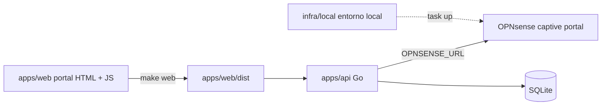

# Byte Services: portal de registro (Wi-Fi de visitantes)

Portal cautivo para los visitantes de Byte Services: el visitante escribe su nombre, cédula, empresa y teléfono, y
recibe 30 minutos de internet. El acceso lo abre OPNsense a través de la API de Byte. Sin código ni WhatsApp.

## Partes del repo



| Carpeta        | Qué es                                                       |
| -------------- | ------------------------------------------------------------ |
| `apps/web/`    | Portal: HTML, CSS y JavaScript sin dependencias              |
| `apps/api/`    | API en Go: registro, sesiones y adaptador de OPNsense        |
| `infra/local/` | Entorno local local: OPNsense en una VM y AP `Byte` en el PC |
| `docker/`      | Imagen y compose para el despliegue                          |
| `docs/`        | Documentación (Diátaxis): decisiones, referencia y guías     |

## Empezar

Comandos del portal y la API (Makefile):

```sh
make web       # compila apps/web/dist
make api       # compila el portal y levanta la API en :8080
make up        # contenedor (imagen + compose)
make down      # para el contenedor
```

Entorno local para probar en un teléfono real (Taskfile en `infra/local`):

```sh
cd infra/local
task up        # imagen, host y VM
task down      # deshace todo
```

Guía completa: [docs/how-to/levantar-local.md](/docs/how-to/levantar-local.md).

## Documentación

- Empieza por [docs/README.md](/docs/README.md): índice de decisiones, referencia, guías y pendientes.
- Producto y diseño: [PRODUCT.md](/PRODUCT.md) y [DESIGN.md](/DESIGN.md).
- Contrato de la API: [docs/reference/api/openapi.yaml](/docs/reference/api/openapi.yaml).

## Pruebas

No hay suite de pruebas automáticas. Se verifica abriendo el portal en el navegador, idealmente a 390×844.
