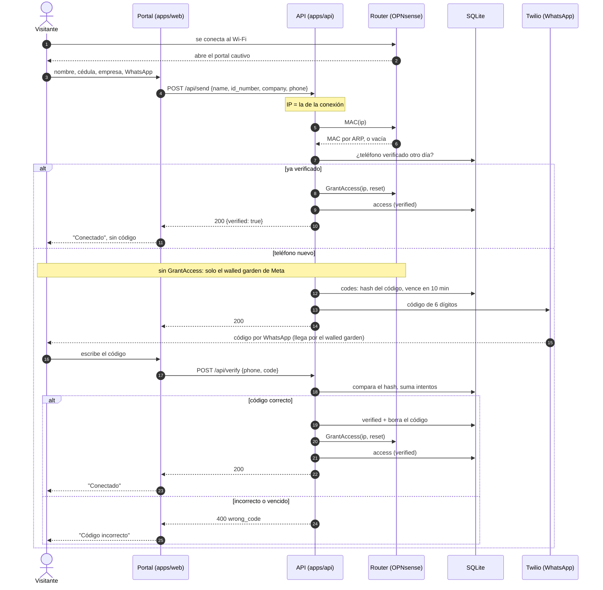
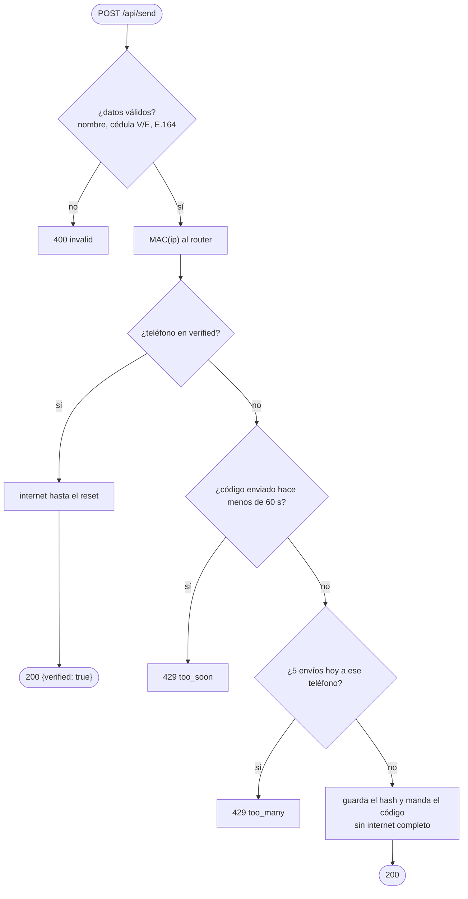
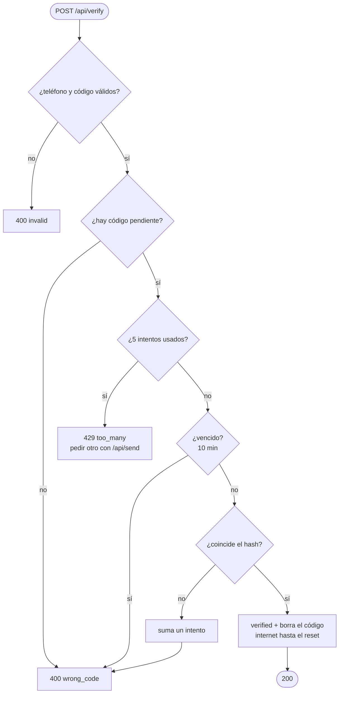

# Acceso al Wi-Fi: walled garden, código y reset diario

> **Estado:** Revisado, por probar en teléfonos reales. Reemplaza la hora gratis al enviar

## Contexto

El código de verificación llega por WhatsApp, pero el visitante no tiene internet hasta verificarlo:
sin datos móviles el código nunca llega. El portal es para un **torneo de un día**

El SO del teléfono abre el portal cautivo porque su prueba de conexión recibe una redirección. Si el dispositivo recibe
internet completo antes del código, el SO cierra el portal y el visitante no llega al paso del OTP. Por eso el
dispositivo **no recibe internet al enviar**

## Decisión

1. Al enviar los datos (`POST /api/send`) el dispositivo no recibe internet. El **walled garden** deja pasar, para
   cualquier dispositivo y de forma permanente, los rangos IP de Meta (WhatsApp incluido). Así el código llega aunque
   el visitante no tenga datos. No hay hora por dispositivo: Meta queda abierto mientras la zona lo tenga
2. Al verificar el código (`POST /api/verify`) el teléfono queda verificado y el dispositivo tiene internet **hasta el reset de las 2:00 AM**
3. Los días siguientes, un teléfono ya verificado entra **sin código**: `POST /api/send` responde `verified: true` y da internet hasta el reset

## Flujo

### Paso a paso

**1. Conexión.** El visitante se conecta al Wi-Fi. El router todavía no le da internet y el sistema operativo abre el
portal cautivo (en iOS y Android, un mini-navegador)

**2. Datos.** El visitante escribe nombre, cédula, empresa donde trabaja y WhatsApp, y el portal llama a `POST /api/send`. La página no manda
nada que identifique al dispositivo: la API toma la **IP de la conexión** y con ella le pide la **MAC al router**, que
la conoce por ARP. Si el router no la sabe, se sigue sin MAC

**3. ¿Ya verificado?** La API busca el teléfono en `verified`. Si lo verificó otro día, no hace falta código: el router
le da internet **hasta el reset**, se registra el acceso y el portal salta directo a "Conectado"

**4. Límites de envío.** Si el teléfono es nuevo, la API revisa que no se haya pedido un código hace menos de 60 s
(`429 too_soon`) ni se hayan hecho ya 5 envíos hoy a ese número (`429 too_many`). Las peticiones del **mismo teléfono**
se atienden de una en una (un lock en memoria por número, el despliegue es una sola instancia), así que dos pestañas o
dos móviles a la vez no generan dos códigos: la segunda recibe `too_soon` y el portal lo interpreta como enviado

**5. Sin internet completo.** Al enviar no se llama a `GrantAccess`: el router no abre internet. Solo funcionan los
rangos de Meta del walled garden, así que el portal sigue abierto y el SO no lo cierra

**6. Código.** La API genera un código de 6 dígitos, guarda solo su hash (vence en 10 min) y lo manda por WhatsApp con
Twilio. El teléfono lo recibe por el walled garden. El portal pasa al paso del código y arranca el contador de reenvío

**7. Verificación.** El visitante escribe el código y el portal llama a `POST /api/verify`. La API busca el código
pendiente de ese teléfono y lo rechaza si no hay (`400 wrong_code`), si ya se usaron los 5 intentos (`429 too_many`:
hay que pedir otro), si venció o si el hash no coincide (`400 wrong_code`; un intento más)

**8. Conectado.** Con el código correcto, los datos pasan a `verified`, el código se borra y el router da internet
**hasta el reset**. A partir de ahí, ese teléfono entra sin código los días siguientes (paso 3)

### Secuencia completa

### Decisión de `POST /api/send`

### Decisión de `POST /api/verify`

La lógica vive en [service.go](/apps/api/core/service.go) (líneas 58-161)

## Razones

- **Walled garden de Meta y no internet al enviar.** Con internet completo al enviar, el SO da la red por conectada y
  cierra el portal antes del OTP. El walled garden deja pasar solo los rangos de Meta, así que WhatsApp llega sin
  internet completo. El costo: Facebook e Instagram quedan abiertos sin verificar. Los rangos salen de RIPEstat para
  AS32934 y AS11917 (241 IPv4 y 320 IPv6 unidos) y son una foto que hay que refrescar
- **Verificar da internet hasta el reset.** Sin un premio por verificar, mucha gente no escribiría el código
- **IP de la petición y no MAC.** El navegador no puede leer la MAC y, pasada por la URL, la escribe el visitante.
  La IP sale de la conexión ([clientIP](/apps/api/adapters/httpapi/handlers.go) (líneas 91-99)) y es lo que usa el
  portal cautivo de OPNsense para abrir el acceso. Requiere que el AP esté en modo puente: con NAT, todos los
  visitantes llegarían con la IP del router
- **MAC del router, no de la página.** El backend se la pide al router con la IP (`Router.MAC`; el router la sabe
  por ARP). Si el router no la conoce, el acceso queda con IP, teléfono y cédula
- **Saltar el código otros días.** El backend recuerda los teléfonos verificados (tabla `verified`); volver al día
  siguiente no obliga a esperar otro WhatsApp

## El reset diario y las horas

- **El día va de reset a reset (2:00 AM a 2:00 AM)**, no de medianoche a medianoche. A la 1:00 AM del 21 todavía es
  el día del 20, así que no se reinician los límites de envío, y todo acceso vence a las 2:00 AM. Lo calcula [window](/apps/api/core/service.go) (líneas 185-195)
- **Todas las horas se guardan en UTC** (ISO 8601 con `Z`): `verified_at`, `expires_at`, `sent_at`, `start_at`,
  `end_at`. La zona horaria (`TIMEZONE`) solo sirve para saber cuándo son las 2:00 AM locales; el log también sale en UTC
- La columna `day` no es una hora sino la etiqueta del día: la fecha local en que empezó (`2026-11-20` para
  todo lo que pasa entre las 2:00 AM del 20 y las 2:00 AM del 21)

## Riesgos asumidos

- **Facebook e Instagram sin verificar:** el walled garden de Meta los deja abiertos antes del OTP
- **Sesiones que no vencen en OPNsense:** la API guarda la hora de fin, pero OPNsense no la aplica todavía
  (`acc_session_timeout` vacío). El acceso puede seguir más allá del reset hasta que se corrija
- **Walled garden desactualizado:** los rangos de Meta cambian. Si WhatsApp deja de llegar, el visitante no recibe
  código y no tiene salida dentro del portal
- **Número ajeno verificado:** quien escriba el teléfono de alguien ya verificado entra sin código

## Límites

| Límite                    | Valor  | Dónde                                                          |
| ------------------------- | ------ | -------------------------------------------------------------- |
| Internet al enviar        | ninguno | `POST /api/send` no llama a `GrantAccess`                     |
| Walled garden             | Meta (AS32934 y AS11917), permanente | zona del portal en OPNsense, `allowedAddresses` |
| Vigencia del código       | 10 min | `CodeTTL`                                                      |
| Espera entre envíos       | 60 s   | `ResendWait`; igual a `WAIT` en el portal                      |
| Envíos por teléfono y día | 5      | `MaxSendsPerDay`                                               |
| Intentos por código       | 5      | `MaxAttempts`; agotados, se pide otro código con `/api/send`   |
| Reset diario              | 02:00  | `RESET_AT`, hora local de `TIMEZONE` (06:00 UTC en Venezuela)  |

Contrato exacto: [openapi.yaml](/docs/reference/api/openapi.yaml)
