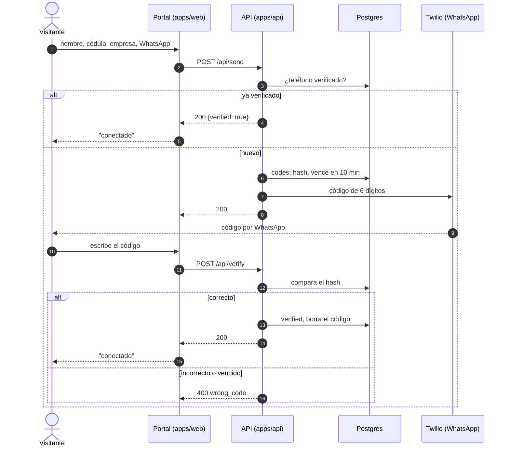

# Acceso: registro con OTP, reset diario y límites

> **Estado:** En revisión

## Contexto

El visitante deja sus datos y confirma su número con un código de 6 dígitos por WhatsApp. El portal no controla el
acceso a internet: el registro sirve para saber quién entró al evento, no para dar o quitar red. Es un evento de un día.

## Decisión

1. `POST /api/send` valida el formulario y manda un código por WhatsApp. El código dura 10 minutos y solo se guarda su hash.
2. `POST /api/verify` compara el código. Si es correcto, el teléfono queda en `verified` con los datos del visitante.
3. Un teléfono ya verificado no recibe código: `POST /api/send` responde `verified: true` y la página pasa a "conectado".
4. Los límites de envío van por día, que empieza a las 2:00 AM local (el reset).

## Flujo

**1. Formulario.** El visitante escribe nombre y apellido, cédula (V o E), empresa y WhatsApp. El teléfono va en E.164.

**2. Envío.** La API valida los datos y revisa:
- Que no se haya mandado un código hace menos de 60 s (`429 too_soon`).
- Que no se hayan hecho 5 envíos hoy a ese número (`429 too_many`).

Si pasa, guarda el hash del código y lo manda por WhatsApp.

**3. Verificación.** El visitante escribe el código. La API responde `400 wrong_code` si no existe, si venció o si el hash no
coincide (cada intento fallido suma uno). Después de 5 intentos fallidos, hay que pedir otro código.

**4. Registrado.** Con el código correcto, el teléfono queda en `verified`, el código se borra y la página muestra "conectado".

### Secuencia

## Límites

| Límite | Valor | Dónde |
|---|---|---|
| Vigencia del código | 10 min | `CodeTTL` |
| Espera entre envíos | 60 s | `ResendWait` (igual a `WAIT` en el portal) |
| Envíos por teléfono y día | 5 | `MaxSendsPerDay` |
| Intentos por código | 5 | `MaxAttempts` |
| Reset diario | 02:00 local | `RESET_AT` y `TIMEZONE` (las horas se guardan en UTC) |

## Riesgos asumidos

- **Sin control de red:** cualquiera puede navegar sin registrarse. El registro no bloquea internet.
- **Número ajeno:** quien escriba un teléfono ya verificado entra sin código en el formulario.
- **Datos del visitante:** nombre, cédula y empresa los escribe el visitante; no se validan contra ningún registro.

Contrato exacto: [openapi.yaml](/docs/reference/api/openapi.yaml)
