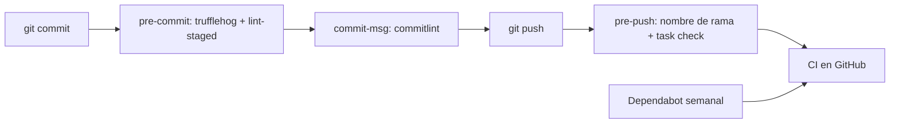

# Pipeline de calidad: hooks, CI y Dependabot

> **Estado:** En revisión

Los mismos chequeos corren en tres momentos: al commitear (lo que está en stage), al hacer push (todo, en local) y en
CI (todo, más la imagen). Dependabot mantiene al día las dependencias y las acciones. No hay CD ni registro de
imágenes: el portal se despliega a mano en el equipo de la red local ([opnsense.md](/docs/reference/setup/opnsense.md))

## Capas

| Momento       | Qué corre                                                                                              | Dónde                                         |
| ------------- | ------------------------------------------------------------------------------------------------------ | --------------------------------------------- |
| pre-commit    | trufflehog sobre el diff en stage; oxfmt, oxlint `--fix`, es-check y gofmt sobre los archivos en stage | [.husky/pre-commit](/.husky/pre-commit)       |
| commit-msg    | Conventional Commits (`feat(api): ...`)                                                                | [.husky/commit-msg](/.husky/commit-msg)       |
| post-checkout | Avisa si la rama no sigue el formato                                                                   | [.husky/post-checkout](/.husky/post-checkout) |
| pre-push      | Bloquea ramas con nombre inválido; `task check` completo                                               | [.husky/pre-push](/.husky/pre-push)           |
| CI            | Todo lo anterior en jobs paralelos, más el build de la imagen y las convenciones del PR                | [ci.yaml](/.github/workflows/ci.yaml)         |
| Dependabot    | PRs semanales de Go, JS, acciones y Terraform                                                          | [dependabot.yaml](/.github/dependabot.yaml)   |

Los hooks se instalan con `pnpm install` (husky, vía `prepare`). `git commit --no-verify` los salta, pero CI corre lo
mismo y no se puede saltar

## Chequeos

| Área   | Chequeo                                          | Herramienta                                                | Tarea                |
| ------ | ------------------------------------------------ | ---------------------------------------------------------- | -------------------- |
| Portal | `pnpm-lock.yaml` al día con `package.json`       | `pnpm install --frozen-lockfile`                           | `task check:web`, CI |
| Portal | Lint estricto                                    | oxlint, `--max-warnings=0`                                 | `pnpm lint`          |
| Portal | Formato de JS, CSS, JSON, Markdown y YAML        | oxfmt                                                      | `pnpm format:check`  |
| Portal | ES2020, sintaxis y APIs                          | es-check `--checkFeatures`                                 | `pnpm es-check`      |
| Portal | Build y presupuesto de 12 KB gzip                | `build.mjs`                                                | `pnpm build`         |
| Portal | Vulnerabilidades y firmas de dependencias        | `pnpm audit`, `pnpm audit signatures`                      | `pnpm audit:deps`    |
| API    | `go.mod`/`go.sum` ordenados y verificados        | `go mod tidy -diff`, `go mod verify`                       | `task api:mod`       |
| API    | Formato (gofmt + goimports)                      | golangci-lint fmt                                          | `task api:fmt`       |
| API    | Lint: bugs, seguridad, recursos sin cerrar       | go vet, golangci-lint ([config](/apps/api/.golangci.yaml)) | `task api:lint`      |
| API    | Tests con detector de carreras                   | `go test -race`                                            | `task api:test`      |
| API    | Vulnerabilidades en código alcanzable            | govulncheck                                                | `task api:vuln`      |
| Repo   | Scripts de shell y hooks                         | shellcheck                                                 | `task repo:shell`    |
| Repo   | Dockerfile                                       | hadolint                                                   | `task repo:docker`   |
| Repo   | Workflows de GitHub                              | actionlint                                                 | `task repo:actions`  |
| Repo   | Terraform del entorno local                      | `terraform fmt`, `terraform validate`                      | `task repo:tf`       |
| Repo   | Secretos en todo el historial                    | trufflehog `--only-verified`                               | `task secrets`       |
| Imagen | El Dockerfile construye con las últimas imágenes | docker buildx (sin push)                                   | solo CI              |
| PR     | Nombre de rama y mensajes de commit              | regex de `.husky/pre-push`, commitlint                     | solo CI              |

`task check` corre todo menos la imagen y las convenciones del PR. shellcheck, hadolint, terraform y trufflehog son
herramientas del sistema. Si no están instaladas, en local la tarea avisa y se salta ese chequeo (CI lo corre igual);
en CI (`CI=true`) el job falla, para que un chequeo nunca quede en verde sin haber corrido

## Decisiones

- **Un solo runner de tareas: Task.** El repo ya lo usaba para `infra/local`; el `Taskfile.yml` raíz lo incluye
  como `local:` y reemplaza al Makefile. `sources`/`generates` evita recompilar las herramientas si no cambiaron
- **pnpm como único gestor.** `preinstall` rechaza npm y yarn. Las dependencias son solo herramientas: el portal
  sigue sin dependencias en runtime y `build.mjs` no importa nada
- **Herramientas de Go como módulos.** golangci-lint, govulncheck y task viven en
  [tools/go.mod](/tools/go.mod) (directiva `tool`) y actionlint en [tools/actionlint/go.mod](/tools/actionlint/go.mod),
  aparte porque su versión de la librería YAML choca con la de golangci-lint. Separadas de `apps/api/go.mod` para que
  sus dependencias no cambien las versiones que compila la API. Dependabot las actualiza como cualquier otra
- **Acciones fijadas por SHA** con la versión en comentario; Dependabot las sube
- **El Dockerfile usa la última imagen** de `node:alpine` y `golang:alpine` sin fijar versión. El job de imagen
  construye en cada push con `pull: true`, así que si una versión nueva rompe el build se ve en CI y no el día del
  despliegue. Por eso Dependabot no vigila Docker
- **Lint de JS estricto** (`--max-warnings=0`), sin reglas de TypeScript. El portal suma las de
  [ES2020](/docs/explanation/web/es2020.md)
- **HTML fuera del formateador.** `build.mjs` reemplaza literalmente `<link rel="stylesheet" href="byte.css">` y
  ``; oxfmt los reescribe como `<link ... />` y el portal saldría sin estilos. El build
  falla si no encuentra esas etiquetas
- **Presupuesto de peso de 12 KB gzip** en `build.mjs`: la página viaja antes de que el visitante tenga internet.
  Subirlo es un cambio explícito, no un efecto secundario
- **Ramas `<tipo>/<descripción>`** (`feature`, `fix`, `refactor`, `hotfix`, `chore`, `docs`) y Conventional Commits.
  `main`, `develop` y `staging` quedan libres

### Descartado

- **CD y registro de imágenes:** no hay servidor al que desplegar; el binario va al OPNsense a mano
- **Lint type-aware (tsgolint):** necesita tipos de TypeScript y el portal es JavaScript sin tipos
- **Fijar versiones en el Dockerfile:** preferencia explícita por la última imagen; el job de imagen cubre el riesgo
