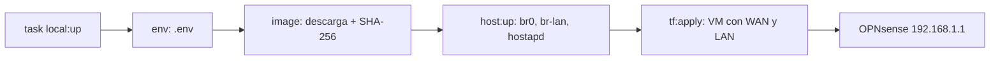
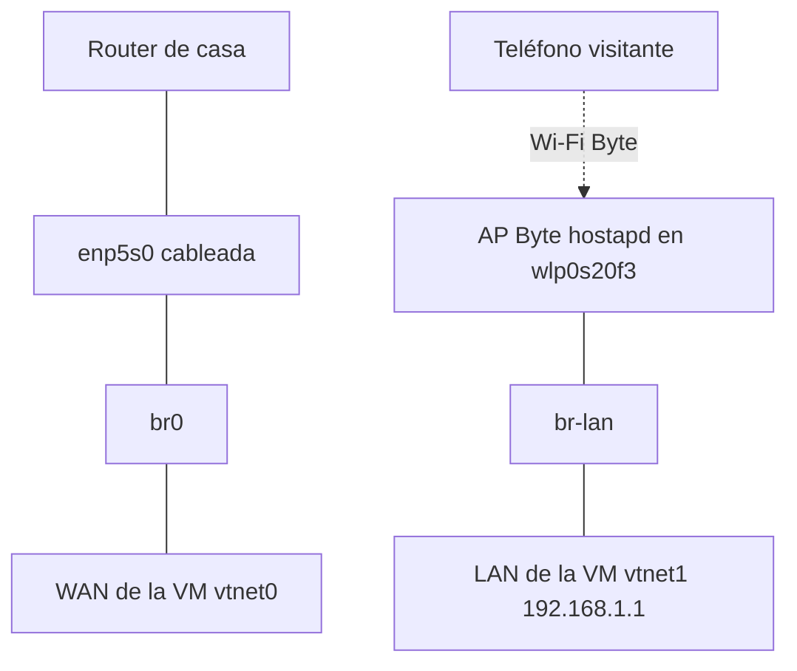

# Levantar el entorno local (OPNsense + AP Byte)

> **Estado:** En revisión. Probado el 24/11/2026 con OPNsense 26.7 (imagen nano) en Ubuntu 24.04 con KVM.

Objetivo: probar el portal cautivo en un teléfono real, con un OPNsense en una VM y un punto de acceso `Byte` en el PC.
El código vive en [infra/local/](/infra/local/README.md).

## Requisitos

| Requisito                                                  | Por qué                                                | Cómo verificar                                               |
| ---------------------------------------------------------- | ------------------------------------------------------ | ------------------------------------------------------------ |
| Linux con virtualización por hardware (Intel VT-x o AMD-V) | KVM acelera la VM                                      | `grep -c -E 'vmx\|svm' /proc/cpuinfo` (mayor que 0)          |
| `/dev/kvm` y módulo cargado                                | Sin esto, la VM no arranca                             | `ls -l /dev/kvm`                                             |
| libvirt y QEMU, con tu usuario en `libvirt` y `kvm`        | Terraform crea la VM sin `sudo`                        | `id -nG \| grep -E 'libvirt\|kvm'`                           |
| Pool `default` de libvirt activo                           | Ahí se guarda el disco de la VM                        | `virsh pool-list`                                            |
| Terraform 1.17.1                                           | Versión fijada del proyecto                            | `terraform version`                                          |
| Task 3.54.0                                                | Ejecuta el Taskfile                                    | `task --version`                                             |
| NetworkManager (`nmcli`)                                   | Crea los puentes y conecta la red                      | `nmcli -v`                                                   |
| `hostapd`                                                  | Emite el Wi-Fi `Byte`                                  | `hostapd -v`                                                 |
| Tarjeta Wi-Fi con modo AP                                  | El AP `Byte` lo necesita                               | `iw list \| grep -A8 'Supported interface modes' \| grep AP` |
| Tarjeta cableada                                           | Da salida a internet a la WAN de la VM                 | `ip -br link`                                                |
| `curl`, `bunzip2`, `sha256sum`                             | Descargar y verificar la imagen                        | `command -v curl bunzip2 sha256sum`                          |
| `sudo`                                                     | Puentes y AP en el host                                | `sudo -v`                                                    |
| ~5 GB libres en disco                                      | Imagen comprimida (470 MB) + descomprimida (3 GB) + VM | `df -h ~`                                                    |
| 4 GB de RAM libres                                         | Memoria de la VM                                       | `free -h`                                                    |
| Teléfono con Wi-Fi                                         | Probar el portal de verdad                             | —                                                            |

Aviso: `task local:host:up` puede cortar tu Wi-Fi actual si `WIFI_CON` está definido, porque la tarjeta pasa a AP.

## Pasos

```sh
task local:up      # desde la raíz del repo: imagen + host + VM
```

Eso ejecuta, en orden:

1. `env` (tarea de la raíz): crea el `.env` desde [.env.example](/.env.example) si no existe.
2. `image`: descarga la imagen oficial de OPNsense, verifica su SHA-256 y la descomprime en `~/.cache/byte-local/images`.
3. `host:up`: crea el puente `br0` (WAN), el puente `br-lan` (LAN) y levanta `hostapd` con la red `Byte`.
4. `tf:apply`: crea la VM con dos NIC: WAN en `br0`, LAN en `br-lan`.

Cuando termine, el panel de OPNsense está en `https://192.168.1.1` desde la red `Byte`.

Para deshacer todo: `task local:down`.

## Flujo



## Red



## Pendiente

- La configuración de OPNsense (zona del portal cautivo, plantilla, DNS y API key) sigue a mano.
- Automatizar el bootstrap de la VM (usuario `root` y API key) está en diseño; ver [pendientes](/docs/pending/).
