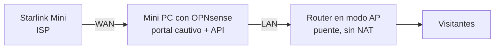

# Equipo y adaptador del router

> **Estado:** Pendiente

Hoy el puerto `Router` solo tiene el adaptador de [log](/apps/api/adapters/router/log.go): registra el acceso sin abrir
nada. Falta confirmar el equipo y escribir el adaptador

## Topología propuesta

- **Starlink Mini** hace de ISP; hay que confirmar que tenga puerto ethernet
- **Mini PC con OPNsense** con dos puertos ethernet (WAN y LAN); si trae uno, un adaptador USB a ethernet para el segundo
- **Router en modo AP:** debe ser puente, sin NAT. Con NAT, OPNsense y la API verían a todos los visitantes con la IP
  y la MAC del router, y no se podría distinguir a nadie

Alternativa si no aparece la mini PC: Raspberry. OPNsense no tiene soporte oficial para ARM, así que haría falta otro
sistema (OpenWrt con openNDS, por ejemplo) y otro adaptador. Con mucha gente, el límite probablemente sea el ancho de
banda del Starlink antes que el equipo: conviene limitar la velocidad por visitante (traffic shaper de OPNsense)

## Dónde corre la API

| Opción                     | Cómo                                                                        |
| -------------------------- | --------------------------------------------------------------------------- |
| En la mini PC con OPNsense | OPNsense es FreeBSD, sin Podman: binario directo (`GOOS=freebsd GOARCH=amd64`). `modernc.org/sqlite` funciona sin cgo |
| Otro equipo en la LAN      | El contenedor, como está                                                    |

En los dos casos la API debe recibir a los visitantes directo (sin proxy delante), porque los identifica por la IP de
la conexión

## Adaptador de OPNsense (por confirmar)

El portal cautivo de OPNsense trabaja por IP, igual que la API. Falta revisar en su documentación:

- Cómo abrir una sesión para una IP desde la API de OPNsense
- Cómo leer la MAC de una IP (sesiones del portal cautivo o tabla ARP)
- Cómo darle a cada sesión un tiempo distinto (1 h gratis, después hasta el reset). Puede requerir RADIUS con
  el atributo `Session-Timeout`
- Cómo servir el portal propio como página del portal cautivo y dejar la API accesible antes de autenticar

## Al decidir

1. Escribir `apps/api/adapters/router/opnsense.go` con `MAC(ctx, ip)` (de la sesión del portal cautivo o la tabla
   ARP de OPNsense) y `GrantAccess(ctx, ip, until)`
2. Elegirlo en [main.go](/apps/api/main.go) según variables de entorno, como el `Sender`
3. Mover este documento a `explanation/ops/` con la decisión
