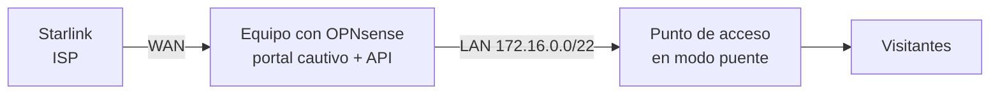

# Equipo real: OPNsense y adaptador del router

> **Estado:** En progreso. El adaptador de OPNsense funciona en `fwportal.byteservices.net`. Pendientes: el arranque tras
> reinicio, el SSID en el Wi-Fi del portal y el caso del Samsung

El puerto `Router` tiene dos adaptadores: [log](/apps/api/adapters/router/log.go), que solo registra el acceso, y
[OPNsense](/apps/api/adapters/router/opnsense.go), que se activa con `OPNSENSE_URL`.

Configuración del equipo: [opnsense.md](/docs/reference/setup/opnsense.md). Errores y pruebas:
[diagnosticar-portal.md](/docs/how-to/diagnosticar-portal.md).

## Estado

| Punto | Estado |
| --- | --- |
| Captive portal en OPNsense con sesión de 30 minutos (hard timeout) | Verificado en la configuración |
| API autorizando la IP del visitante | Funciona: los dispositivos iPhone y Pixel navegan |
| MAC por ARP | Pendiente de confirmar en el equipo real |
| Samsung: abre el portal al conectarse | Resuelto el 24/11/2026 quitando el override de `gstatic` |
| Pixel sin el override de `gstatic` | Funciona (24/11/2026) |
| API arranca sola tras reinicio de OPNsense | **Pendiente** |
| Nombre de la red en la página (`NETWORK_NAME`) | Configurado como `Byte_Services` en la propuesta; confirmar en el Wi-Fi real |

## Topología

El punto de acceso debe estar en modo puente, sin NAT. Con NAT, OPNsense vería a todos los visitantes con la IP del
router y la API no podría distinguirlos.

## Dónde corre la API

| Opción | Cómo |
| --- | --- |
| En OPNsense (el caso actual) | Binario FreeBSD (`GOOS=freebsd GOARCH=amd64`). Sin cgo, `modernc.org/sqlite` funciona |
| Otro equipo en la LAN | Contenedor, como está en [contenedores.md](/docs/explanation/ops/contenedores.md) |

En los dos casos la API recibe a los visitantes sin proxy delante. El proxy local de `lighttpd` es la excepción
documentada: reenvía desde `127.0.0.1` y la API lee la IP real de `X-Forwarded-For`.

## Adaptador de OPNsense

| Método del puerto | Llamada a OPNsense |
| --- | --- |
| `MAC(ctx, ip)` | `GET /api/diagnostics/interface/getArp`, busca la IP en la tabla ARP |
| `GrantAccess(ctx, ip, until)` | `POST /api/captiveportal/session/connect` con `zoneid`, `ip` y `sessionTimeout` (segundos hasta `until`) |

Variables: [variables-de-entorno.md](/docs/reference/setup/variables-de-entorno.md).

## Pendiente

1. Hacer que la API arranque sola tras un reinicio de OPNsense (servicio `rc.d` o equivalente)
2. Confirmar la MAC del visitante en *Status → Captive Portal → Sessions* (el adaptador la toma de ARP)
4. Confirmar qué sirve DHCP en `172.16.0.0/22` antes de cambiar nada de red
5. Rotar la API key si alguna vez apareció en un chat o log compartido
