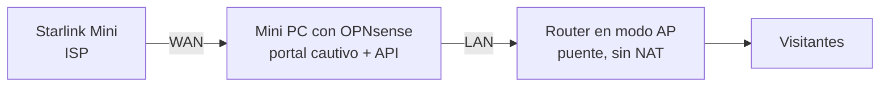

# Equipo y adaptador del router

> **Estado:** En progreso. El adaptador de OPNsense está escrito y probado contra una VM; falta el equipo real y cerrar
> la duración de las sesiones

El puerto `Router` tiene dos adaptadores: el de [log](/apps/api/adapters/router/log.go), que solo registra el acceso,
y el de [OPNsense](/apps/api/adapters/router/opnsense.go), que se activa si `OPNSENSE_URL` está definida

## Topología propuesta

- **Starlink Mini** hace de ISP; hay que confirmar que tenga puerto ethernet
- **Mini PC con OPNsense** con dos puertos ethernet (WAN y LAN); si trae uno, un adaptador USB a ethernet para el segundo
- **Router en modo AP:** debe ser puente, sin NAT. Con NAT, OPNsense y la API verían a todos los visitantes con la IP
  y la MAC del router, y no se podría distinguir a nadie

Alternativa si no aparece la mini PC: Raspberry. OPNsense no tiene soporte oficial para ARM, así que haría falta otro
sistema (OpenWrt con openNDS, por ejemplo) y otro adaptador. Con mucha gente, el límite probablemente sea el ancho de
banda del Starlink antes que el equipo: conviene limitar la velocidad por visitante (traffic shaper de OPNsense)

## Dónde corre la API

| Opción                     | Cómo                                                                        |
| -------------------------- | --------------------------------------------------------------------------- |
| En la mini PC con OPNsense | OPNsense es FreeBSD, sin Podman: binario directo (`GOOS=freebsd GOARCH=amd64`). `modernc.org/sqlite` funciona sin cgo |
| Otro equipo en la LAN      | El contenedor, como está                                                    |

En los dos casos la API debe recibir a los visitantes directo (sin proxy delante), porque los identifica por la IP de
la conexión

## Adaptador de OPNsense

El adaptador usa la API de OPNsense con una API key (Basic auth) y verifica el certificado de la GUI con su CA.

| Método del puerto      | Llamada a OPNsense                                                    |
| ---------------------- | --------------------------------------------------------------------- |
| `MAC(ctx, ip)`         | `GET /api/diagnostics/interface/getArp`, busca la IP en la tabla ARP   |
| `GrantAccess(ctx, ip, until)` | `POST /api/captiveportal/session/connect` con `zoneid`, `ip` y `sessionTimeout` |

Variables de entorno de la API:

| Variable               | Uso                                                                     |
| ---------------------- | ----------------------------------------------------------------------- |
| `OPNSENSE_URL`         | Dirección de la GUI, por ejemplo `https://192.168.122.10`               |
| `OPNSENSE_KEY`, `OPNSENSE_SECRET` | Key y secret de la API de un usuario de OPNsense              |
| `OPNSENSE_ZONE`        | ID de la zona del portal (por defecto `0`)                              |
| `OPNSENSE_CA_FILE`     | PEM de la CA o del certificado de la GUI, si no es público              |
| `OPNSENSE_SERVER_NAME` | Nombre que trae el certificado en su SAN, por ejemplo `OPNsense.internal`. Hace falta si la URL usa una IP |

### Limitaciones conocidas

- **Duración de la sesión:** `sessionTimeout` no quedó registrado en la VM (`acc_session_timeout` vacío). Por ahora la
  sesión no vence sola en OPNsense, aunque la API guarde `until`. Falta confirmar si la zona necesita `hardtimeout` o
  RADIUS con `Session-Timeout` para vencer a las 02:00.
- **MAC:** sale de la tabla ARP. Si el visitante no tiene entrada ARP reciente, `MAC` devuelve vacío y el servicio lo
  trata como desconocido. Al pedir el código el visitante acaba de hacer una petición, así que normalmente hay entrada.
- **Portal propio:** pendiente decidir cómo servir la página del portal y dejar la API accesible antes de autenticar.

## Pendiente

1. Confirmar la duración de las sesiones (`hardtimeout` o RADIUS) y que vencen al reset de las 02:00
2. Probar con el equipo real (Starlink, router en modo AP) y un visitante real
3. Mover este documento a `explanation/ops/` cuando se cierren los puntos anteriores
