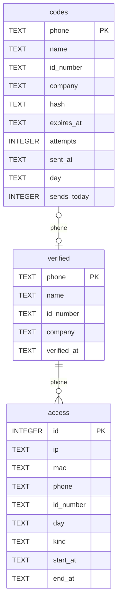

# Esquema de la base

> **Estado:** Aprobado

SQLite, tablas `STRICT`. Fuente: [0001_init.sql](/apps/api/adapters/sqlite/migrations/0001_init.sql). Versión
aplicada: `PRAGMA user_version`

Las relaciones son lógicas (por `phone`); no hay claves foráneas: `access` registra también accesos de
teléfonos que nunca verificaron (la hora gratis de antes; desde el walled garden ya no se crean)

## `verified`

Teléfonos que pasaron el código; se saltan el código los días siguientes

| Columna       | Tipo | Regla                                    |
| ------------- | ---- | ---------------------------------------- |
| `phone`       | TEXT | PK. E.164: `+[1-9]`, 9 a 16 caracteres   |
| `name`        | TEXT | 3 a 100 caracteres                       |
| `id_number`   | TEXT | `V` o `E` + 6 a 8 dígitos (`V18456789`)  |
| `company`     | TEXT | 2 a 100 caracteres: empresa donde trabaja |
| `verified_at` | TEXT | ISO 8601 UTC                             |

## `codes`

Un código pendiente por teléfono; cada envío reemplaza al anterior y reinicia `attempts`. Se borra al verificar

| Columna       | Tipo    | Regla                                                  |
| ------------- | ------- | ------------------------------------------------------ |
| `phone`       | TEXT    | PK. E.164                                              |
| `name`        | TEXT    | 3 a 100 caracteres; pasa a `verified` al verificar     |
| `id_number`   | TEXT    | Igual que en `verified`                                |
| `company`     | TEXT    | Igual que en `verified`                                |
| `hash`        | TEXT    | 64 caracteres: HMAC-SHA256 en hex de `phone:código`    |
| `expires_at`  | TEXT    | ISO 8601 UTC                                           |
| `attempts`    | INTEGER | ≥ 0                                                    |
| `sent_at`     | TEXT    | ISO 8601 UTC                                           |
| `day`         | TEXT    | Día de reset a reset: fecha local en que empezó        |
| `sends_today` | INTEGER | ≥ 1; vuelve a 1 cuando cambia `day`                    |

## `access`

Cada vez que se da internet (al verificar o al entrar sin código): queda como registro del torneo. Ya no hay hora gratis al enviar

| Columna     | Tipo    | Regla                                   |
| ----------- | ------- | --------------------------------------- |
| `id`        | INTEGER | PK                                      |
| `ip`        | TEXT    | IPv4 o IPv6 canónica, la de la petición |
| `mac`       | TEXT    | EUI-48 (`AA:BB:CC:DD:EE:FF`) que da el router; NULL si no la conoce |
| `phone`     | TEXT    | E.164                                   |
| `id_number` | TEXT    | Igual que en `verified`                 |
| `day`       | TEXT    | Día de reset a reset (`YYYY-MM-DD`)     |
| `kind`      | TEXT    | `free` o `verified`                     |
| `start_at`  | TEXT    | ISO 8601 UTC                            |
| `end_at`    | TEXT    | ISO 8601 UTC, mayor que `start_at`      |

Índices `access_ip_day`, `access_mac_day`, `access_phone_day` y `access_id_number_day` (cada uno con `day, kind`): quedan de la consulta de la hora gratis que se quitó; se conservan
hasta decidir si se borran con una migración nueva
