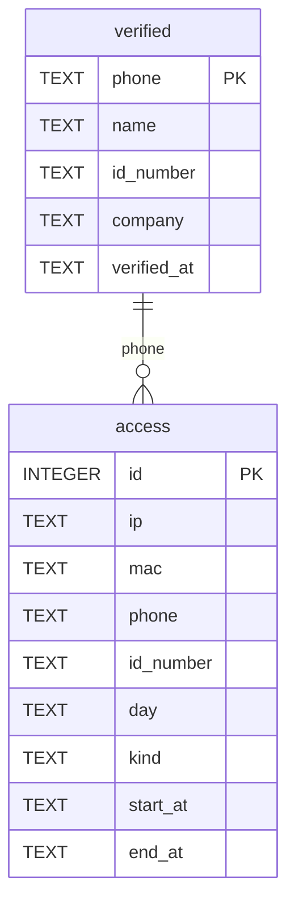

# Esquema de la base

> **Estado:** Aprobado

SQLite, tablas `STRICT`. Fuente: [0001_init.sql](/apps/api/adapters/sqlite/migrations/0001_init.sql). Versión
aplicada: `PRAGMA user_version`

Las relaciones son lógicas (por `phone`); no hay claves foráneas.

## `verified`

Visitantes que enviaron el formulario. Cada envío actualiza sus datos y `verified_at`

| Columna       | Tipo | Regla                                     |
| ------------- | ---- | ----------------------------------------- |
| `phone`       | TEXT | PK. E.164: `+[1-9]`, 9 a 16 caracteres    |
| `name`        | TEXT | 3 a 100 caracteres                        |
| `id_number`   | TEXT | `V` o `E` + 6 a 8 dígitos (`V18456789`)   |
| `company`     | TEXT | 2 a 100 caracteres: empresa donde trabaja |
| `verified_at` | TEXT | ISO 8601 UTC                              |

## `access`

Cada sesión de internet abierta: un registro por envío del formulario (30 minutos)

| Columna     | Tipo    | Regla                                                                |
| ----------- | ------- | -------------------------------------------------------------------- |
| `id`        | INTEGER | PK                                                                   |
| `ip`        | TEXT    | IPv4 o IPv6, la de la petición (IP real si vino del proxy local)     |
| `mac`       | TEXT    | EUI-48 (`AA:BB:CC:DD:EE:FF`) que da el router; NULL si no la conoce  |
| `phone`     | TEXT    | E.164                                                                |
| `id_number` | TEXT    | `V` o `E` + dígitos                                                  |
| `day`       | TEXT    | Fecha local (`YYYY-MM-DD`) en la que empezó la sesión                |
| `kind`      | TEXT    | Solo `verified`                                                      |
| `start_at`  | TEXT    | ISO 8601 UTC                                                         |
| `end_at`    | TEXT    | ISO 8601 UTC, mayor que `start_at`; 30 minutos después               |

No hay índices definidos en la migración inicial.
