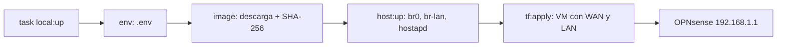
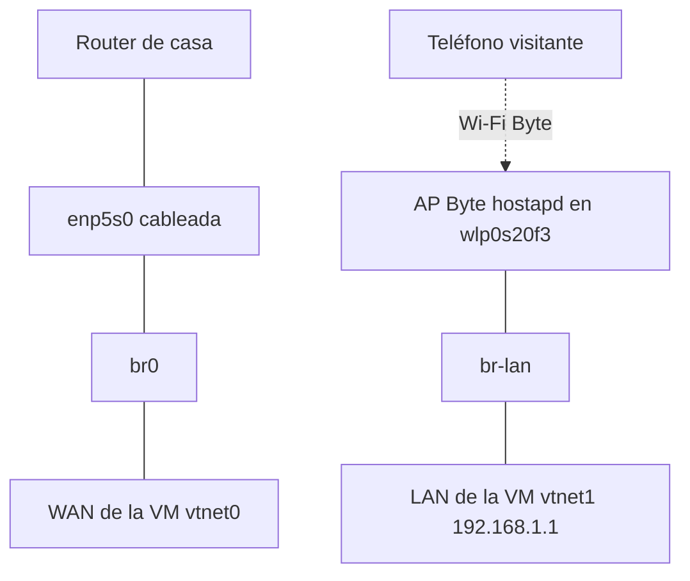

# Entorno local (OPNsense + AP Byte)

Levanta un OPNsense en una VM de libvirt y un punto de acceso `Byte` en el PC, para probar el portal en un teléfono.
Guía completa: [docs/how-to/levantar-local.md](/docs/how-to/levantar-local.md).

## Requisitos

| Requisito                                                  | Por qué                                                | Cómo verificar                                               |
| ---------------------------------------------------------- | ------------------------------------------------------ | ------------------------------------------------------------ |
| Linux con virtualización por hardware (Intel VT-x o AMD-V) | KVM acelera la VM                                      | `grep -c -E 'vmx\|svm' /proc/cpuinfo` (mayor que 0)          |
| `/dev/kvm` y módulo cargado                                | Sin esto, la VM no arranca                             | `ls -l /dev/kvm`                                             |
| libvirt y QEMU, con tu usuario en `libvirt` y `kvm`        | Terraform crea la VM sin `sudo`                        | `id -nG \| grep -E 'libvirt\|kvm'`                           |
| Pool `default` de libvirt activo                           | Ahí se guarda el disco de la VM                        | `virsh pool-list`                                            |
| Terraform 1.17.x                                           | Versión fijada del proyecto                            | `terraform version`                                          |
| Task 3.54.0                                                | Ejecuta el Taskfile                                    | `task --version`                                             |
| NetworkManager (`nmcli`)                                   | Crea los puentes y conecta la red                      | `nmcli -v`                                                   |
| `hostapd`                                                  | Emite el Wi-Fi `Byte`                                  | `hostapd -v`                                                 |
| Tarjeta Wi-Fi con modo AP                                  | El AP `Byte` lo necesita                               | `iw list \| grep -A8 'Supported interface modes' \| grep AP` |
| Tarjeta cableada                                           | Da salida a internet a la WAN de la VM                 | `ip -br link`                                                |
| `curl`, `bunzip2`, `sha256sum`                             | Descargar y verificar la imagen                        | `command -v curl bunzip2 sha256sum`                          |
| `sudo`                                                     | Puentes y AP en el host                                | `sudo -v`                                                    |
| ~5 GB libres en disco                                      | Imagen comprimida (470 MB) + descomprimida (3 GB) + VM | `df -h ~`                                                    |
| 4 GB de RAM libres                                         | Memoria de la VM                                       | `free -h`                                                    |
| Teléfono con Wi-Fi                                         | Probar el portal de verdad                             | —                                                            |

Aviso: `task local:host:up` puede cortar tu Wi-Fi actual si `WIFI_CON` está definido, porque la tarjeta pasa a AP.

## Uso

Desde la raíz del repo: el [Taskfile raíz](/Taskfile.yml) incluye este como `local:`.

```sh
task local:up        # primera vez: .env, imagen, host y VM
task local:down      # destruye la VM y deshace el host
task --list          # todas las tareas
```

Variables en el `.env` de la raíz del repo (se crea desde [/.env.example](/.env.example) y no se sube al repo). Cada una tiene su comentario en el ejemplo.

## Flujo



## Red



## Qué hace cada tarea

| Tarea                                 | Qué hace                                                                       |
| ------------------------------------- | ------------------------------------------------------------------------------ |
| `:env` (raíz)                         | Crea `.env` en la raíz desde `.env.example` si falta                           |
| `image`                               | Descarga la imagen nano de OPNsense 26.7, verifica su SHA-256 y la descomprime |
| `host:up`                             | Crea `br0`, `br-lan` y levanta el AP `Byte` (requiere `sudo`)                  |
| `host:down`                           | Quita el AP y los puentes, y devuelve la cableada a NetworkManager             |
| `tf:plan` / `tf:apply` / `tf:destroy` | Gestiona la VM con Terraform (provider libvirt 0.8.3)                          |

## Pendiente

- La configuración de OPNsense (zona del portal, plantilla, DNS y API key) sigue a mano.
- El bootstrap automático de `root` y la API key está en diseño.
